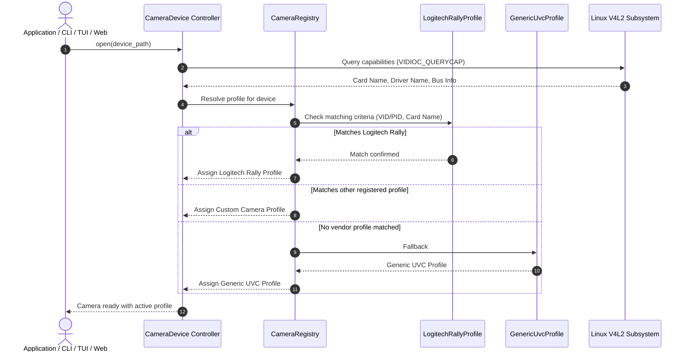

# OpenPTZ System Architecture

This document outlines the high-level system architecture of **OpenPTZ**, its subsystem boundaries, communication protocols, and the modular camera profile abstraction layer.

---

## 1. High-Level Architecture Overview

OpenPTZ follows a decoupled multi-tier architecture separating user-facing presentation, persistence, hardware abstraction, and operating system device drivers.

### Architecture Diagram

```mermaid
flowchart TD
    subgraph PresentationTier ["1. Presentation & Interface Tier"]
        CLI["CLI Interface"]
        TUI["Terminal UI (TUI)"]
        WEB["Web GUI (HTML5)"]
        API["REST API (HTTP/JSON)"]
    end

    subgraph StateTier ["2. State & Coordination Tier"]
        PRESET["PresetManager (~/.config/openptz/presets.json)"]
    end

    subgraph AbstractionTier ["3. Hardware Abstraction & Profile Tier"]
        REGISTRY["CameraRegistry"]
        TRAIT["CameraProfile Abstraction"]
        GEN_PROF["Generic UVC Profile"]
        RALLY_PROF["Logitech Rally Profile"]
        FUTURE_PROF["Custom Profiles (Aver, PTZOptics, Obsbot)"]

        REGISTRY --> TRAIT
        TRAIT <|.. GEN_PROF
        TRAIT <|.. RALLY_PROF
        TRAIT <|.. FUTURE_PROF
    end

    subgraph DriverTier ["4. Core Device & Driver Tier (Linux)"]
        DEV["CameraDevice (V4L2 Device Controller)"]
        IOCTL["ioctl System Call Interface (VIDIOC / UVCIOC)"]
    end

    subgraph HardwareTier ["5. Hardware & Kernel Subsystem"]
        KERNEL["Linux Kernel (uvcvideo)"]
        V4L2_DEV["/dev/video* Device Nodes"]
        UVC_STD["UVC Camera Terminal (Pan, Tilt, Zoom Absolute/Relative)"]
        UVC_XU["UVC Extension Units (Logitech XU 10 & 11, Vendor XUs)"]
        STREAM["Video Streaming (MJPEG / H.264 / YUYV)"]
    end

    %% Interactions
    CLI --> DEV
    CLI --> PRESET
    TUI --> DEV
    TUI --> PRESET
    WEB --> API
    API --> DEV
    API --> PRESET
    PRESET --> DEV

    DEV --> REGISTRY
    DEV --> IOCTL
    IOCTL --> KERNEL
    KERNEL --> V4L2_DEV
    V4L2_DEV --> UVC_STD
    V4L2_DEV --> UVC_XU
    V4L2_DEV -.-> STREAM
    STREAM -.-> WEB
```

---

## 2. Subsystem Boundaries & Responsibilities

### 2.1 Interface Layer (`src/api`, `src/tui`, `src/cli.rs`)
- **Command Line Interface (CLI)**: Non-interactive interface for scripting, system automation, and external tool integration. Provides direct single-shot commands (pan, tilt, zoom, presets, device listing).
- **Terminal User Interface (TUI)**: Interactive full-terminal console with real-time Pan/Tilt coordinate reticle, status gauges, anti-flicker controls, and keyboard navigation.
- **REST API Server**: Embedded HTTP/JSON server exposing endpoints for camera motion, coordinate queries, and hardware presets. Serves external automation engines (such as Elgato Stream Deck and Bitfocus Companion).
- **Web User Interface (Web GUI)**: Single-page browser interface providing a live HTML5 camera preview, Click-to-Aim interactive controls, and visual preset slots.

### 2.2 State & Presets (`src/presets.rs`)
- **Preset Persistence**: Manages named software presets serialized to `~/.config/openptz/presets.json`.
- **Hybrid Slot Bridging**: Bridges hardware EEPROM preset indices (`1..8`) with arbitrary named software coordinate bookmarks (`podium`, `whiteboard`, `speaker`).

### 2.3 Device Controller & Platform Driver (`src/v4l2/`)
- **Device Controller (`CameraDevice`)**: Safe Linux device handle encapsulating open file descriptors for `/dev/video*`. Manages ioctl dispatching, safety bounds clamping, and control queries.
- **FFI Ioctl Interface**: Low-level kernel interface mapping standard V4L2 commands (`VIDIOC_QUERYCAP`, `VIDIOC_G_CTRL`, `VIDIOC_S_CTRL`, `VIDIOC_QUERYCTRL`) and UVC Extension Unit calls (`UVCIOC_CTRL_QUERY`).

### 2.4 Hardware Abstraction & Profiles (`src/cameras/`)
- Decouples vendor-specific coordinate scales, zoom curves, and proprietary extension units from generic V4L2 camera management.
- Exposes uniform physical units (degrees, magnification factors) to all higher-level consumers.

---

## 3. Modular Camera Profile Pattern

### 3.1 Architectural Motivation
While standard UVC cameras use common video controls, mechanical and protocol implementations diverge:
- **Angle Representation**: Vendors utilize wildly different step resolutions (e.g. 3,600 raw units per degree for Logitech Rally versus 64 or 100 units per degree in other industrial cameras).
- **Zoom Ranges**: Zoom values vary from raw optical motor steps to focal lengths in tenths of millimeters or normalized percentages.
- **Proprietary Vendor Protocols (XU)**: Extended capabilities (motor recalibration, sleep/privacy behaviors, EEPROM storage, ISP crop zoom) are exposed via vendor-specific USB UVC Extension Units.

The **Modular Camera Profile Pattern** abstracts these differences behind a unified contract.

### 3.2 Camera Profile Contract Specifications

Each camera profile defines:
1. **Device Identification**:
   - Matches detected devices by USB Vendor ID (VID), Product ID (PID), or V4L2 card name strings.
2. **Axis & Motion Boundaries**:
   - Minimum and maximum physical angles in degrees for horizontal Pan and vertical Tilt.
   - Mechanical step resolution and raw units per degree conversion ratios.
3. **Zoom Characteristics**:
   - Minimum and maximum magnification factors (e.g. 1.0x to 15.0x).
   - Raw register mapping and interpolation curves (linear vs logarithmic).
4. **Coordinate Mapping Protocol**:
   - Bidirectional conversion between real-world degrees and hardware integer registers with boundary clamping.
5. **Hardware Extensions (XU)**:
   - Recalibration and physical home routines.
   - Non-volatile hardware EEPROM preset storage and recall where available.
   - Vendor-specific sleep and wake routines.

### 3.3 Dynamic Profile Discovery & Resolution

When opening a device node, OpenPTZ dynamically identifies the hardware model:



---

## 4. Guide: Adding a New Camera Profile

Adding support for an additional PTZ camera model (such as Aver, PTZOptics, or Obsbot) requires completing the following phases:

### Phase 1: Hardware Specification Audit
1. **Identify USB Descriptors**: Determine the USB Vendor ID (VID) and Product ID (PID) via `lsusb`.
2. **Query V4L2 Controls**: Inspect control IDs, ranges, and step sizes on the video device node via `v4l2-ctl --list-ctrls-menus`.
3. **Determine Mechanical Limits**: Document the manufacturer's specified horizontal pan range, vertical tilt range, optical zoom factor, and digital zoom limits from technical datasheets.

### Phase 2: Coordinate & Unit Ratio Derivation
1. **Calculate Raw Units per Degree**:
   - Divide the raw register travel distance by the physical angular degrees.
   - Example: A range of `-612,000` to `+612,000` over `-170.0°` to `+170.0°` equates to `3,600` raw units per degree.
   - Example: A range of `-1,800` to `+1,800` over `-180.0°` to `+180.0°` equates to `10` raw units per degree (0.1° resolution).
2. **Derive Zoom Scaling**:
   - Define the relationship between raw zoom register integers and human-readable zoom factors (e.g., 1.0x to 20.0x).

### Phase 3: Profile Implementation
1. Create a dedicated module in `src/cameras/<vendor_model>.rs`.
2. Define the device matching criteria (USB VID/PID and card name patterns).
3. Specify pan and tilt axis boundaries (`min_deg`, `max_deg`, `step_deg`, `raw_units_per_deg`).
4. Specify zoom limits (`min_x`, `max_x`, `step_x`, `raw_min`, `raw_max`).
5. Implement conversion formulas with boundary clamping.
6. Implement home/reset routines and hardware presets if supported by the camera's hardware.

### Phase 4: Registry Integration
1. Register the new profile module in `src/cameras/mod.rs`.
2. Place the new profile in the discovery table ahead of the fallback `GenericUvcProfile`.

### Phase 5: Verification & Testing
1. **Coordinate Round-Trip Verification**: Confirm that degree-to-raw and raw-to-degree conversions preserve precision.
2. **Clamping Verification**: Ensure that values beyond physical limits are clamped without integer overflow or hardware faults.
3. **Integration Verification**: Verify that the camera is recognized automatically upon launch in CLI, TUI, and Web GUI.
