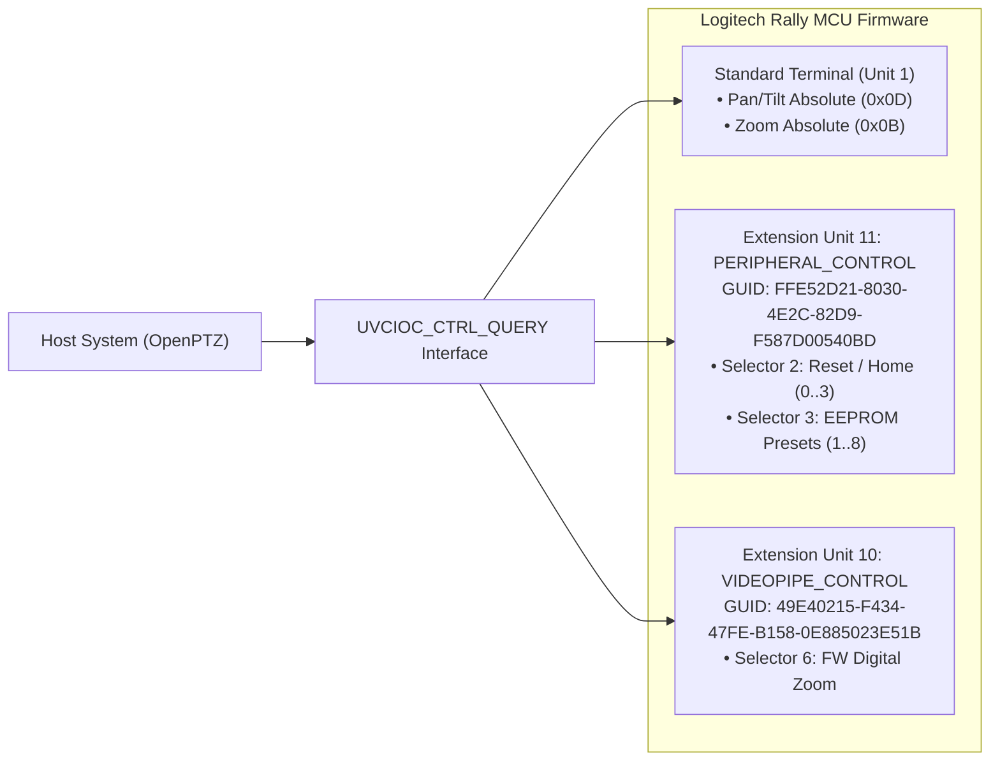

# Logitech Rally Camera Technical Reference

Detailed technical hardware specification and protocol reference for the **Logitech Rally Camera** (`046d:0881`) on Linux systems.

---

## 1. Hardware Overview & Device Identification

The **Logitech Rally Camera** is a 4K Ultra-HD conference PTZ camera with a mechanical pan-tilt-zoom motor system, 15x hybrid optical/digital zoom, and motorized privacy parking.

| Property | Value |
| :--- | :--- |
| **Vendor Name** | Logitech Inc. |
| **Product Name** | Rally Camera / Rally Plus |
| **USB Vendor ID (VID)** | `0x046d` |
| **USB Product ID (PID)** | `0x0881` |
| **USB Interface Protocol** | USB 3.0 (SuperSpeed) / USB 2.0 (HighSpeed fallback) |
| **Linux Kernel Driver** | `uvcvideo` |
| **V4L2 Card Name** | `Logitech Rally Camera` |
| **V4L2 Primary Node** | `/dev/video0` (video stream + PTZ control endpoint) |
| **V4L2 Auxiliary Node** | `/dev/video1` (metadata / H.264 stream endpoint) |

---

## 2. Mechanical & Optical Specifications

### 2.1 Motion Boundaries & Register Mapping

The camera translates angular position into arcseconds (**3,600 raw units per degree**):

| Axis / Function | Mechanical Range | Raw V4L2 Register Range | Step Resolution | Default Position |
| :--- | :--- | :--- | :--- | :--- |
| **Pan** | `-90.0°` to `+90.0°` (180° total) | `-324000` to `+324000` | `3600` (1.0°) | `0` (Center) |
| **Tilt** | `-90.0°` (Down) to `+50.0°` (Up) | `-324000` to `+180000` | `3600` (1.0°) | `0` (Level) |
| **Zoom** | `1.0x` to `15.0x` (15x Total) | `100` to `1500` | `1` (0.01x) | `100` (1.0x) |
| **Pan Speed** | Left / Stop / Right | `-1`, `0`, `+1` | `1` | `0` (Stopped) |
| **Tilt Speed** | Down / Stop / Up | `-1`, `0`, `+1` | `1` | `0` (Stopped) |

### 2.2 Mathematical Conversion Specifications

- **Pan Coordinate Conversion**:
  - `Raw_Pan = clamp(round(Degrees_Pan * 3600), -324000, 324000)`
  - `Degrees_Pan = Raw_Pan / 3600.0`
- **Tilt Coordinate Conversion**:
  - `Raw_Tilt = clamp(round(Degrees_Tilt * 3600), -324000, 180000)`
  - `Degrees_Tilt = Raw_Tilt / 3600.0`
- **Zoom Factor Conversion**:
  - `Raw_Zoom = clamp(round(Zoom_Factor * 100), 100, 1500)`
  - `Zoom_Factor = Raw_Zoom / 100.0`

---

## 3. UVC Extension Units (XU) Protocol Specification

In addition to standard USB Video Class controls, the Rally camera exposes two proprietary Logitech UVC Extension Units defined in the USB device descriptors for low-level motor recalibration, firmware diagnostics, and hardware EEPROM presets.

### 3.1 Unit 11: `LOGITECH_XU_PERIPHERAL_CONTROL`

- **Unit ID**: `11` (`0x0B`)
- **GUID**: `{FFE52D21-8030-4E2C-82D9-F587D00540BD}`
- **Binary UUID (Little Endian)**: `21 2d e5 ff 30 80 2c 4e 82 d9 f5 87 d0 05 40 bd`

#### Selector 2: `PANTILT_RESET` (`0x02`)
Triggers mechanical recalibration and motor zeroing routines:
- **UVC Request**: `UVC_SET_CUR` (`0x01`)
- **Payload Size**: 1 byte (`uint8`)
- **Register Values**:
  - `0x00`: Idle / No operation
  - `0x01`: Reset Pan motor only
  - `0x02`: Reset Tilt motor only
  - `0x03`: Reset Pan & Tilt motors (Full Home recalibration)

#### Selector 3: `PANTILT_PRESET` (`0x03`)
Interfaces directly with internal EEPROM non-volatile preset memory:
- **UVC Request**: `UVC_SET_CUR` (`0x01`)
- **Payload Size**: 2 bytes
- **Payload Structure**:
  - **Byte 0 (Action)**:
    - `0x01`: Recall Preset (Move motors to stored EEPROM coordinates)
    - `0x02`: Save Preset (Commit current motor position to EEPROM slot)
  - **Byte 1 (Slot Index)**: `0x01` through `0x08` (Slots 1 to 8)

---

### 3.2 Unit 10: `LOGITECH_XU_VIDEOPIPE_CONTROL`

- **Unit ID**: `10` (`0x0A`)
- **GUID**: `{49E40215-F434-47FE-B158-0E885023E51B}`
- **Binary UUID (Little Endian)**: `15 02 e4 49 34 f4 fe 47 b1 58 0e 88 50 23 e5 1b`

#### Selector 6: `XU_VIDEO_FW_ZOOM_CONTROL` (`0x06`)
- Interfaces with the onboard ISP image scaler for digital crop zooming beyond optical limits.

---

## 4. Hardware Quirks & Operational Constraints

### 4.1 Selector 2 Stall Hazard (USB Endpoint STALL)

> [!CAUTION]
> **Commands sent to Extension Unit 11, Selector 2 must strictly be in the range `0..3`.**
>
> Values greater than 3 trigger an unhandled branch in the MCU firmware, causing an immediate USB control pipe **STALL** condition (`-EPIPE` / error code 32, surfacing in kernel as `-EBUSY`).
> Once stalled, all subsequent XU operations fail until the device is power-cycled or the USB port root hub is reset via hardware bus power cycling.

### 4.2 Anti-Flicker Power Line Frequency Registers

Sensor integration time must match local AC grid frequency to eliminate rolling shutter banding:
- **V4L2 Control ID**: `V4L2_CID_POWER_LINE_FREQUENCY` (`0x00980918`)
- **Values**:
  - `0`: Disabled (outdoor daylight)
  - `1`: 50 Hz (PAL regions: Europe, UK, Asia, Australia, Africa)
  - `2`: 60 Hz (NTSC regions: Americas, Japan, Taiwan, Korea)

### 4.3 Motor Sleep & Physical Privacy Parking

- **Automatic Parking**: When all file descriptors to `/dev/video*` are closed, the camera automatically tilts down to `-90.0°` (lens facing into the metal housing).
- **Wake Calibration Window**: Upon reopening the device, firmware initiates a ~1.5-second motor wake calibration sweep back to `(0.0°, 0.0°, 1.0x)`. Commands dispatched during this window return `EBUSY` or are discarded by the MCU.

### 4.4 USB Bandwidth Requirements

- Operates over USB 3.0 SuperSpeed (5 Gbps) for 4K 30fps YUV / NV12 / MJPEG.
- When connected via USB 2.0 HighSpeed (480 Mbps), video streams are constrained to MJPEG compression and higher latency.
